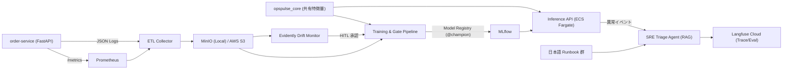

# OpsPulse MLOps — SaaS運用障害検知・復旧支援 MLOps プラットフォーム

> **B2B SaaS マイクロサービス向け 異常検知・ドリフト監視・AI一次障害分析プラットフォーム**
>
> *当前状态：`v0.1.0-poc`（初期 PoC 基盤稼働中）→ Sprint 1〜4 にて準本番 MLOps / LLMOps 基盤へ拡張予定*

---

## 1. プロジェクト概要（背景と目的）

本プロジェクトは、日本の中堅 B2B SaaS 企業が運用する注文マイクロサービス（`order-service`）における運用課題を解決するための、エンドツーエンド MLOps / LLMOps プラットフォームです。

### 解決する課題
1. **静的閾値アラートの誤報・見逃し**：キャンペーン時の正常なトラフィック急増で誤報（オオカミ少年アラート）が多発する一方、緩やかなメモリリークや DB 接続プール枯渇の初期予兆を見逃してしまう。
2. **ML モデルの運用属人化**：モデル学習・評価・デプロイ・劣化検知・ロールバックが自動化されておらず、本番継続運用ができない。
3. **一次切り分け（トリアージ）の負荷**：障害発生時、オンコール担当者がログと運用手順書（Runbook）を手動照合しており MTTR が長い。

---

## 2. システム全体構成



詳細は [docs/01_architecture.md](docs/01_architecture.md) および [docs/02_adr/](docs/02_adr/) を参照してください。

---

## 3. 技術スタック

| 領域 | 採用技術 | 役割 |
| :--- | :--- | :--- |
| **言語・管理** | Python 3.11+ / `uv` / `ruff` / `pytest` | 依存固定・静的解析・自動テスト |
| **ML・データ契約** | Scikit-learn / LightGBM / Pandera / Pydantic | 異常検知モデル・入力スキーマ検証・Train-Serving 一貫性 |
| **実験・モデル管理** | MLflow (`@champion` / `@challenger` Aliases) | 実験トラッキング・モデル登録・バージョン切替・ロールバック |
| **API・推論基盤** | FastAPI / Docker / AWS ECS Fargate / ECR | コンテナ化推論 API・ローリングデプロイ |
| **インフラ・CI/CD** | Terraform / GitHub Actions / MinIO → AWS S3 | IaC・CI/CD・人工承認（HITL）再学習パイプライン |
| **監視・ドリフト** | Prometheus / Grafana / Evidently | システム指標監視・データドリフト検知 |
| **AI Agent・LLMOps** | RAG (日本語 Runbook) / Langfuse Cloud | 障害原因の一次分析・プロンプト/応答トレース＆オフライン評価 |

---

## 4. 現在の進捗（v0.1 引き継ぎ状況と Sprint 計画）

| フェーズ | ステータス | 主な内容 | 担当 |
| :--- | :--- | :--- | :--- |
| **v0.1 PoC（既存）** | ✅ 完了 | 模擬業務アプリ (`target_app`)、故障注入ツール、静的閾値推論 API、日本語 Runbook 4本、基本設計書 | 初期開発（引き継ぎ済） |
| **Sprint 1 (W1-2)** | 🚧 着手待ち | MinIO/Postgres/MLflow 基盤構築、ETL 収集パイプライン、共有特徴量＋ML ベースライン学習 | メンバーA / メンバーB |
| **Sprint 2 (W3-4)** | 📋 計画済 | MLflow 品質ゲート＆`@champion` 推論切替、CI 自動化、推論 API 負荷試験 | メンバーA / メンバーB |
| **Sprint 3 (W5-6)** | 📋 計画済 | Terraform による AWS ECS 構築、Grafana 監視、Evidently ドリフト検知＋HITL 再学習＆ロールバック演習 | メンバーA / メンバーB |
| **Sprint 4 (W7-8)** | 📋 計画済 | SRE Triage Agent (RAG)＋Langfuse 評価、セキュリティ監査、日本語運用手順書＆実績レポート | メンバーA / メンバーB |

---

## 5. クイックスタート（Day 1 動作確認）

新メンバーはまず [docs/00_onboarding.md](docs/00_onboarding.md) を確認してください。

### ローカル Python モード（Docker 未導入でも即確認可能）
```bash
# 1. 環境構築（uv 推奨、なければ python3 -m venv で自動作成）
make setup

# 2. 単体テスト実行
make test

# 3. ターミナルを 3 つ開いて v0.1 PoC を体験
make run-target       # 模擬注文サービス (http://localhost:8001)
make run-inference    # 現行の静的閾値推論 API (http://localhost:8002)
make inject-drift     # 正常トラフィック急増を注入し、現行ルールの誤報を確認！
```

### Docker Compose モード
```bash
cp .env.example .env
make up
make inject-memleak
```

---

## 6. チーム体制と担当境界

- **メンバー A（Platform / MLOps 基盤担当）**：AWS / Terraform / Docker / ECS / CI・CD / データ収集基盤 / Prometheus・Grafana / ロールバック機構
- **メンバー B（ML / LLMOps 開発担当）**：データ契約・共有特徴量 / 異常検知モデル / MLflow 管理 / Evidently ドリフト監視 / RAG 障害分析 Agent / Langfuse 評価

タスク一覧は [docs/03_sprint_backlog.md](docs/03_sprint_backlog.md) を参照してください。
